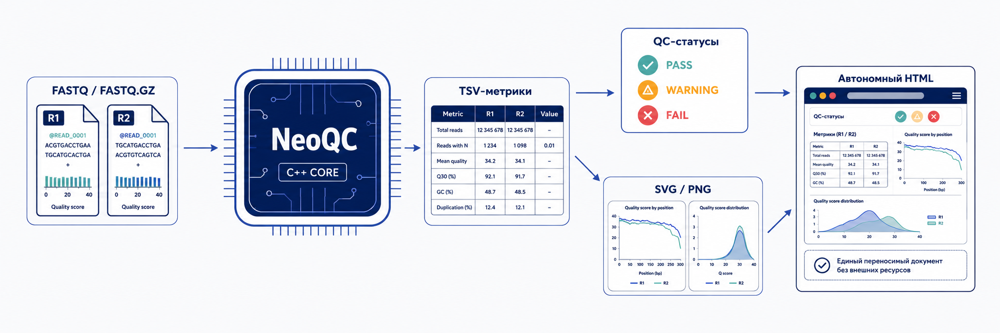

# NeoQC

**Быстрый и воспроизводимый контроль качества FASTQ-данных NGS.**

**Текущая версия:** `1.2.1`

NeoQC — инструмент первичного контроля качества данных секвенирования нового поколения (NGS). Он принимает FASTQ-данные, выполняет структурную проверку и расчёт набора метрик качества, формирует техническую оценку `PASS / WARNING / FAIL` и создаёт автономный HTML-отчёт.

Вычислительное ядро NeoQC реализовано на C++20 и использует OpenMP для параллельной обработки. Построение графиков и оценка QC выполняются Python-модулями.

<p align="center">
  
</p>

---

## 1. Назначение

После секвенирования биологического материала результатом являются файлы FASTQ, содержащие последовательности прочтений и значения качества для каждого основания.

До последующего анализа необходимо проверить, что полученные данные не содержат очевидных технических проблем.

Упрощённо этот этап выглядит так:

```text
Секвенирование
      │
      ▼
    FASTQ
      │
      ▼
Контроль качества
      │
      ▼
Фильтрация / триммирование
      │
      ▼
Повторный контроль качества
      │
      ▼
Выравнивание / количественный анализ
      │
      ▼
Последующий анализ
```

NeoQC выполняет **контроль качества FASTQ** и, при запуске с `--trim`,
предварительную обработку reads с повторным QC до и после тримминга. Он не
выполняет alignment, variant calling или предсказание неоэпитопов.

Подробнее о FASTQ, paired-end секвенировании и месте QC в NGS-процессе:

[`docs/FastQ_origin_paired_end_and_plot_legends.md`](docs/FastQ_origin_paired_end_and_plot_legends.md)

---

## 2. Возможности

- FASTQ и `FASTQ.GZ`;
- single-end и paired-end библиотеки;
- проверка структуры FASTQ-записей;
- проверка согласованности R1/R2;
- параллельная обработка FASTQ через OpenMP;
- Phred-качество;
- качество по позициям;
- распределение среднего качества по прочтениям;
- GC-состав;
- состав A/C/G/T/N по позициям;
- содержание N;
- распределение длин прочтений;
- содержание адаптеров;
- точный расчёт дупликации 50-нуклеотидных префиксов;
- поиск overrepresented sequences;
- версионируемые правила технической оценки;
- статусы `PASS / WARNING / FAIL`;
- SVG и PNG-графики;
- автономный HTML-отчёт;
- триммирование адаптеров, низкокачественных концов и terminal polyG/polyX;
- фильтрация reads по минимальной длине после тримминга;
- отдельный HTML-отчёт с сопоставлением QC до и после тримминга;
- пакетная обработка через `samples.csv`.

---

## 3. Системные требования

### Оперативная память

NeoQC хранит в памяти структуры для точного расчёта дупликации и выполняет
обработку в несколько потоков. Практический ориентир для одного запуска —
**16-20 ГБ доступной ОЗУ**.

Это не фиксированный минимум: фактическое потребление памяти зависит от
размера FASTQ, числа и длины reads, paired-end режима, разнообразия
последовательностей и числа потоков. Для крупных наборов данных рекомендуется
иметь запас, близкий к **24 ГБ ОЗУ**, и не запускать несколько таких анализов
одновременно без оценки доступной памяти.

Программные зависимости для сборки и графиков приведены в
[`docs/INSTALL.md`](docs/INSTALL.md).

---

## 4. Установка

Подробная инструкция:

**[`docs/INSTALL.md`](docs/INSTALL.md)**

Краткий вариант:

```bash
./build.sh
```

При первой конфигурации сборка сама создаст `venv/` и установит зависимости
из `requirements.txt`. Активировать окружение или вручную выполнять
`pip install` не требуется: NeoQC и CTest используют этот Python автоматически.

После успешной сборки исполняемый файл находится в:

```text
build/neoqc
```

Проверка сборки:

```bash
ctest --test-dir build --output-on-failure
```

---

## 5. Быстрый запуск

### Single-end

```bash
./build/neoqc \
  --r1 sample.fastq.gz \
  --sample-id sample01 \
  --out results/sample01 \
  --plot
```

### Paired-end

```bash
./build/neoqc \
  --r1 sample_R1.fastq.gz \
  --r2 sample_R2.fastq.gz \
  --sample-id sample01 \
  --out results/sample01 \
  --plot
```

После выполнения при использовании `--plot` создаётся:

```text
results/sample01/neoqc_qc_report.html
```

Файл можно открыть непосредственно в браузере.

### Тримминг и сравнение QC до/после

Опция `--trim` включает запись оттриммированных FASTQ, QC исходных и итоговых
reads. В сочетании с `--plot` создаётся объединённый отчёт
`neoqc_trimming_report.html`.

```bash
./build/neoqc \
  --r1 sample_R1.fastq.gz \
  --r2 sample_R2.fastq.gz \
  --sample-id sample01 \
  --out results/sample01 \
  --full-trim \
  --plot
```

`--full-trim` включает стандартный профиль: адаптеры из набора NeoQC,
обрезку по качеству с 5′ и 3′ концов и скользящим окном, terminal polyG/polyX
и минимальную длину read `50` п.н. Порог качества — `20`, размер окна — `4`.
Профиль не включает коррекцию перекрытий, объединение пар и извлечение UMI:
эти операции зависят от типа библиотеки и задаются отдельными параметрами.
Явно заданные параметры после `--full-trim` могут уточнить профиль, например
`--full-trim --min-length 75`.

Подробное руководство:

**[`docs/USAGE.md`](docs/USAGE.md)**

---

## 6. Командная строка

| Параметр | Назначение |
|---|---|
| `--r1 <file>` | FASTQ-файл R1. |
| `--r2 <file>` | FASTQ-файл R2 для paired-end анализа. |
| `--sample-id <id>` | Идентификатор образца. |
| `--out <dir>` | Каталог результатов. |
| `--samples <csv>` | Проверка или пакетный анализ таблицы образцов. |
| `--plot` | Построение графиков, QC-оценки и HTML-отчёта. |
| `--trim` | Триммирование, запись итоговых FASTQ и QC до/после. |
| `--full-trim` | Стандартный профиль полного тримминга с безопасными настройками по умолчанию. |
| `--skip-adapters` | Отключение поиска адаптеров. |
| `--timing` | Вывод времени выполнения этапов анализа. |
| `--help`, `-h` | Вывод справки. |

---

## 7. Пакетный анализ

Для нескольких образцов используется таблица `samples.csv`.

Пример:

[`examples/samples.csv`](examples/samples.csv)

Проверить таблицу:

```bash
./build/neoqc --samples examples/samples.csv
```

Запустить анализ:

```bash
./build/neoqc \
  --samples examples/samples.csv \
  --out results \
  --plot
```

Результаты организуются по схеме:

```text
<out>/
└── <patient_id>/
    └── <sample_id>/
        ├── результаты R1/R2
        ├── qc_evaluation.json
        └── neoqc_qc_report.html
```

Для случая также формируется машинно-читаемая сводка `case_summary.json`.

Формат таблицы и ограничения batch-режима описаны в [`docs/USAGE.md`](docs/USAGE.md).

---

## 8. Результаты анализа

Типичный каталог результата:

```text
results/sample01/
├── *_summary.txt
├── per_cycle_R*.tsv
├── per_sequence_quality_R*.tsv
├── per_base_sequence_content_R*.tsv
├── per_sequence_gc_content_R*.tsv
├── per_base_n_content_R*.tsv
├── sequence_length_distribution_R*.tsv
├── sequence_duplication_levels_R*.tsv
├── sequence_duplication_summary_R*.tsv
├── overrepresented_sequences_R*.tsv
├── adapter_content_R*.tsv
├── qc_evaluation.json
├── neoqc_qc_report.html
└── plots/
    ├── plots_manifest.json
    ├── *.svg        # графики на английском
    ├── *.ru.svg     # те же графики с русскими подписями
    └── *.png
```

### TSV

TSV-файлы содержат рассчитанные наблюдения отдельных метрик.

### `qc_evaluation.json`

Содержит машинно-читаемую техническую оценку, наблюдаемые значения, применённые пороги и информацию об активном ruleset.

### HTML-отчёт

HTML-отчёт объединяет итоговые QC-статусы, основную статистику, графики R1/R2, наблюдаемые значения с порогами и таблицы сверхпредставленных последовательностей.

- **автономный:** шрифты, графики (встроенный SVG), стили и скрипты находятся внутри одного файла — отчёт открывается без интернета и без NeoQC;
- **светлая и тёмная тема** — графики перекрашиваются вместе со страницей; печать и PDF всегда светлые;
- **английский и русский язык** — переключаются в левой панели без перегенерации, включая подписи на графиках;
- **порядок разделов:** «Приоритет» (сначала FAIL и WARNING, прошедшие модули свёрнуты в конце) или «По порядку»;
- работает на экранах от телефона до широкого монитора.

Подробное описание — [`docs/html-report.md`](docs/html-report.md).

### Результаты при `--trim`

Для запуска с триммингом итоговый каталог дополнительно содержит:

```text
results/sample01/
├── trimmed/
│   ├── R1.trimmed.fastq.gz
│   ├── R2.trimmed.fastq.gz          # для paired-end
│   └── merged.fastq.gz              # только с --merge
├── qc/
│   ├── before/                      # QC исходных reads
│   └── after/                       # QC после тримминга
└── neoqc_trimming_report.html       # сравнение до/после
```

Отчёт содержит статистику reads и bases, параметры запущенного тримминга,
основную статистику и QC-модули до/после для R1 и R2.

---

## 9. Метрики

| Метрика | Что оценивается |
|---|---|
| Per-base sequence quality | Изменение качества оснований вдоль прочтения. |
| Per-sequence quality scores | Распределение среднего качества отдельных прочтений. |
| Per-base sequence content | Распределение A/C/G/T по позициям. |
| Per-sequence GC content | Распределение GC-содержания прочтений. |
| Per-base N content | Доля неопределённых оснований N по позициям. |
| Sequence length distribution | Распределение длин прочтений. |
| Sequence duplication | Доля дубликатов относительно определённого 50-nt ключа. |
| Adapter content | Содержание известных адаптерных последовательностей. |
| Overrepresented sequences | Последовательности, встречающиеся не менее чем в 0,1% прочтений. |

Подробное описание метрик:

[`docs/QC_METRICS.md`](docs/QC_METRICS.md)

Подробное описание графиков и легенд:

[`docs/FastQ_origin_paired_end_and_plot_legends.md`](docs/FastQ_origin_paired_end_and_plot_legends.md)

Технический контракт графиков:

[`docs/plots.md`](docs/plots.md)

---

## 10. QC-статусы

| Статус | Значение |
|---|---|
| `PASS` | Значение соответствует заданным критериям. |
| `WARNING` | Значение пересекло предупреждающий порог. |
| `FAIL` | Значение пересекло порог отказа. |

Пороги задаются версионируемым ruleset.

Текущий профиль:

```text
fastqc-compatible-v1
```

Название означает совместимость семантики технических порогов с выбранным профилем FastQC; это не означает, что все внутренние алгоритмы NeoQC численно идентичны FastQC.

Подробнее:

[`docs/qc-status-engine.md`](docs/qc-status-engine.md)

---

## 11. Особенности расчёта

### Дупликация

NeoQC использует точный ключ из первых 50 нуклеотидов прочтения.

Каждый уникальный 50-nt префикс учитывается на протяжении всего входного файла. Ограничение по количеству наблюдаемых уникальных последовательностей не применяется.

Это обеспечивает точность для определённого ключа, но потребление памяти зависит от количества уникальных префиксов.

Подробнее:

[`docs/sequence-duplication.md`](docs/sequence-duplication.md)

### Адаптеры

Для поиска адаптеров используется отдельный версионируемый набор NeoQC:

```text
neoqc-standard-v1
```

Он является собственным набором NeoQC и не заявляется как буквальная копия внутреннего списка FastQC.


---

## 12. Ограничения

NeoQC является инструментом технического контроля качества FASTQ.

Он не выполняет:

- выравнивание на референс;
- variant calling;
- количественную оценку экспрессии;
- HLA typing;
- предсказание неоэпитопов.

Полученные QC-статусы требуют интерпретации с учётом типа библиотеки, протокола подготовки и последующего анализа.

---

## 13. Тестирование

После сборки рекомендуется выполнить:

```bash
ctest --test-dir build --output-on-failure
```

Тестовый набор включает проверки FASTQ-парсинга, ошибок структуры, Phred, N, GC, качества, дупликации, адаптеров, sample sheet, QC rules, графиков, HTML-отчёта и batch-обработки.

Тестовые FASTQ-данные генерируются средствами проекта.

---

## 14. Документация

| Документ | Назначение |
|---|---|
| [`docs/INSTALL.md`](docs/INSTALL.md) | Установка, зависимости и сборка. |
| [`docs/USAGE.md`](docs/USAGE.md) | Подробное руководство по запуску. |
| [`docs/QC_METRICS.md`](docs/QC_METRICS.md) | Определение метрик. |
| [`docs/FastQ_origin_paired_end_and_plot_legends.md`](docs/FastQ_origin_paired_end_and_plot_legends.md) | FASTQ, paired-end, место QC в NGS-процессе и интерпретация графиков. |
| [`docs/plots.md`](docs/plots.md) | Технический контракт графиков. |
| [`docs/html-report.md`](docs/html-report.md) | HTML-отчёт: интерфейс, темы, языки, контракт данных, доработка и тесты. |
| [`docs/qc-status-engine.md`](docs/qc-status-engine.md) | Движок технической оценки. |
| [`docs/sequence-duplication.md`](docs/sequence-duplication.md) | Метод расчёта дупликации. |

---

## 15. Версия и статус проекта

**NeoQC `v1.2.1`**

NeoQC используется как инструмент контроля качества NGS-данных в составе проекта **neo-mRNA-vax**.

Проект предназначен для внутреннего использования.
